# Smart Farm Monitoring System - User Manual

For Farm Owners, Farm Workers, Technicians and Smart Farm company staff. Screens show the demo farm and the customer farms of the test setup.

## 1. About this manual

This manual explains how to use the Smart Farm Monitoring System day to day. It is written for the three kinds of people who use the app. You only need the chapters for your role.

| Role | What you do | Chapters |
|---|---|---|
| Farm Owner | Sets up the farm and zones, decides the automation rules and schedules, manages staff accounts, reads reports. Can also do everything the others can. | All |
| Farm Worker | Watches the dashboard, starts and stops pumps, fans and feeders, and acknowledges alerts after checking the zone. | 2, 3, 7, 8, 9 |
| Technician | Registers sensors and actuators, reports faults and repairs devices, tests devices and farm scenarios in the Farm Lab. | 2, 4, 7, 9 |
| Company Admin (Smart Farm) | Creates customer farms, invites owners and company staff, opens any farm as its owner, keeps the shared device catalog. | 2, 11 |
| Company Support (Smart Farm) | Opens only the farms assigned to them, as a technician, while the owner allows support. | 2, 11 |

Words such as **zone**, **sensor**, **actuator** and **threshold** are explained in the Glossary at the end.

## 2. Getting started

### 2.1 Sign in

1. Open the app in a web browser (on the farm computer this is usually http://localhost:3000).
2. Type the username the Farm Owner gave you (on the demo farm: **owner**, **worker** or **technician**). Capital letters and spaces before or after the name do not matter.
3. Type your password and press **Enter** or click **Sign in**.

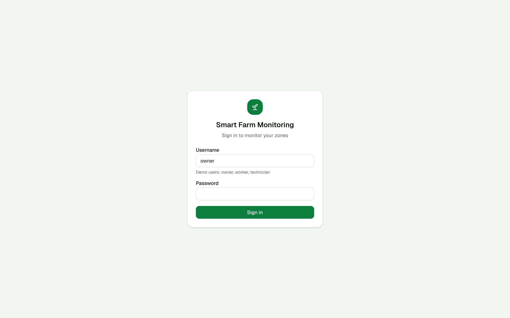
*Figure 1. The sign-in page*

If the username or password is wrong, the page says so. For safety it does not tell you which of the two was wrong. After **5 wrong passwords** the username is locked for 15 minutes, which stops strangers from guessing. If you forgot your password, ask the Farm Owner to reset it; that also unlocks the account at once.

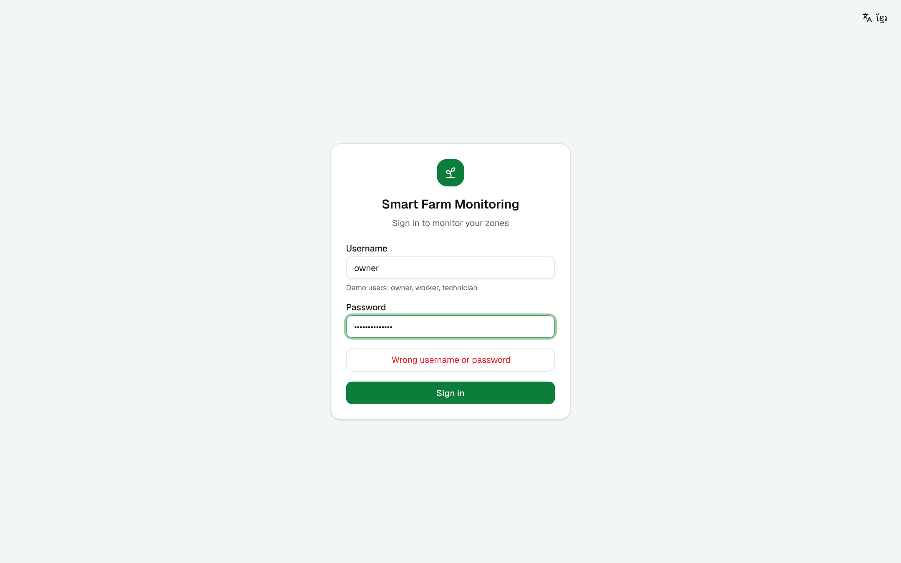
*Figure 2. Wrong username or password*

You stay signed in for 12 hours, even if the server restarts in the meantime. After that, or if an owner or admin resets your password, you are asked to sign in again. Nothing you saved is lost.

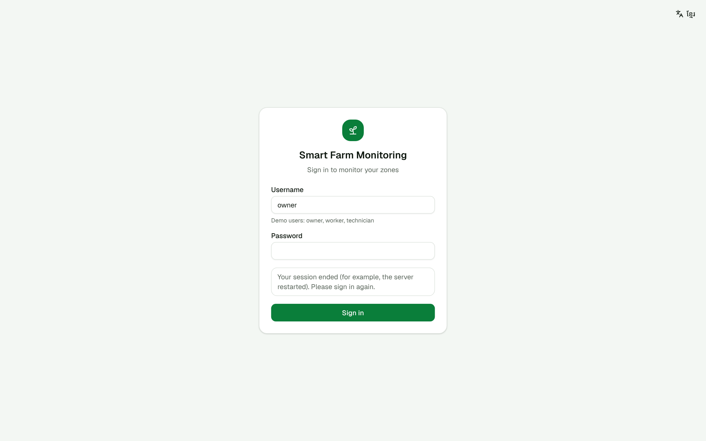
*Figure 3. Your session ended: sign in again*

### 2.1b Your first sign-in: the invite link

New farm owners and new company staff do not get a password from anyone. Smart Farm sends a **one-time link** (by Telegram or SMS) that is valid for **7 days**.

1. Open the link. It greets you by name and shows your username and your farm.
2. Type a new password of at least 8 characters, type it again, and click **Set password and sign in**.
3. You are signed in. The link now stops working, so nobody else can use it.

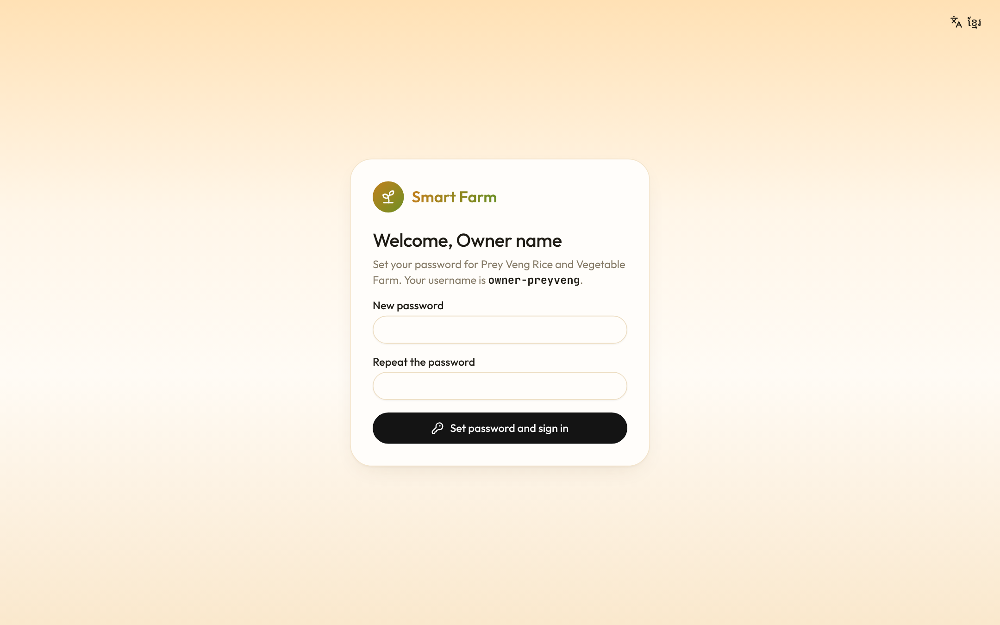
*Figure 4. Set your password from the invite link*

If the page says **This link no longer works**, it was already used or is older than 7 days. Ask Smart Farm for a new link; the old one then stays invalid.

### 2.2 Change your password

Do this the first time you sign in with the password the server generated.

1. Click the **key icon** at the top right.
2. Type your current password, then the new password twice (at least 8 characters).
3. Click **Change password**. Use the new password from the next sign-in.

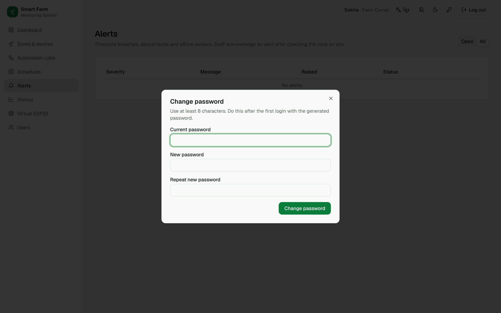
*Figure 5. Change password*

### 2.3 Moving around

- The menu on the left opens Dashboard, Zones & devices, Automation rules, Schedules, Alerts, History and (for the owner) Users. On a phone the menu is at the bottom of the screen (chapter 9).
- The red number next to **Alerts** is how many alerts are still open.
- The **language button** (next to the bell) switches between Khmer and English (section 2.4).
- The **bell icon** turns the alert sound on or off (section 3.3).
- The **moon icon** switches to dark mode, which is easier on the eyes at night. The app remembers your choice.
- **Log out** signs you out on this device.

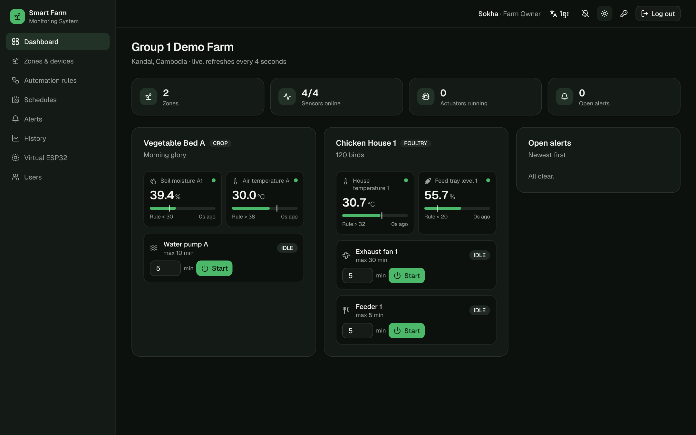
*Figure 6. Dark mode*

### 2.4 Khmer or English

Click the **language button** at the top right (it shows the word Khmer in Khmer script; it is also on the sign-in page) to show the menus, dashboard, alerts and history in Khmer. Click it again (it then shows **EN**) to go back to English. Each phone or computer remembers its own choice.

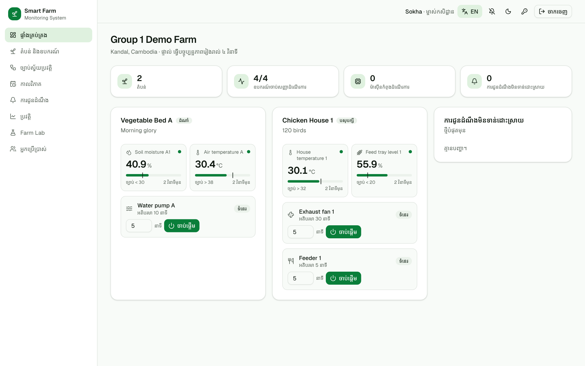
*Figure 7. The dashboard in Khmer*

> **Note:** Names you type (farm, zones, devices) and alert messages from the server stay as they were written. The setup forms for owners and technicians are in English.

## 3. Dashboard

The dashboard is the home page. It refreshes by itself every 4 seconds, so you can leave it open on a screen in the farm office.

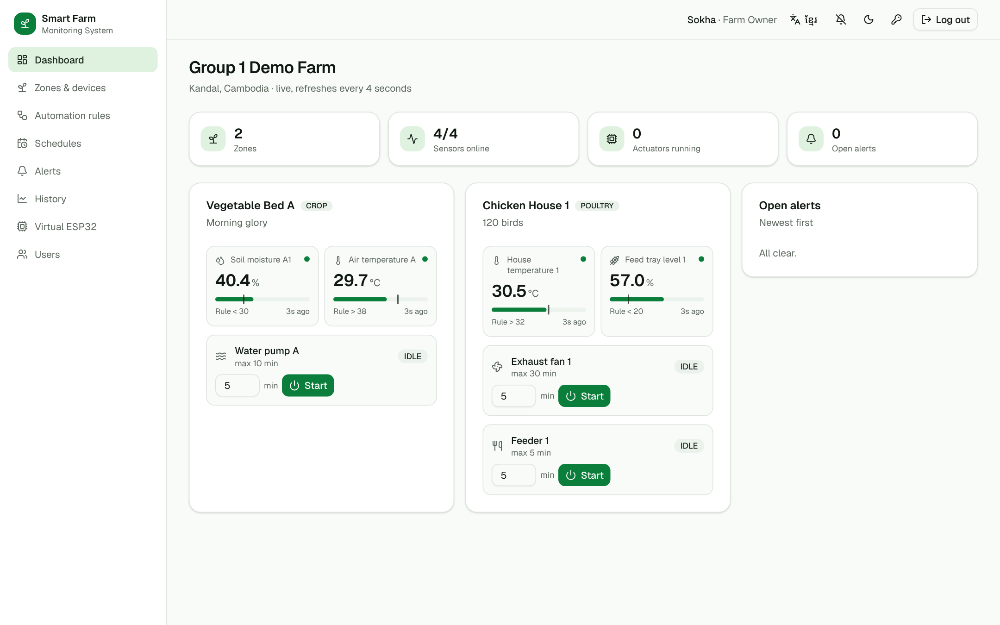
*Figure 8. Dashboard of the Farm Owner*

### 3.1 Reading the dashboard

| Part | What it tells you |
|---|---|
| Top cards | Number of zones, how many sensors are online, how many actuators are running, and how many alerts are open. |
| Zone card | One card per zone with its sensors and actuators. |
| Sensor tile | The latest value and unit. The bar shows where the value sits in the sensor's range; the small black mark is the rule's threshold, written underneath (for example "Rule < 30"). The value and bar turn **red** when a rule's threshold is crossed. Green dot = online, red dot = no reading for 2 minutes or reported faulty, amber dot = under repair; "5s ago" tells how fresh the value is. A sensor that is faulty or under repair is greyed out and its rules are paused. **Click a tile** to open that sensor's history. |
| Actuator row | Pump, fan, feeder, heater, mister, light or tank valve with its status: IDLE (off), RUNNING (shows time left), FAULT, OFFLINE or MAINTENANCE. |
| Open alerts | The newest open alerts. "×3" means the same problem happened 3 times. Click View all alerts for the full list. |

The four cards at the top are also links: click **Open alerts** to go to the alert list.

### 3.2 Start or stop a pump, fan, heater or other actuator (Worker, Owner)

1. Find the actuator in its zone card.
2. Type how many minutes it should run in the small box. Each device has a safety limit, for example 10 minutes for a pump.
3. Click **Start**. The status changes to RUNNING with the time left.
4. To stop it early, click **Stop**. If you do nothing, it switches off by itself when the time is up.

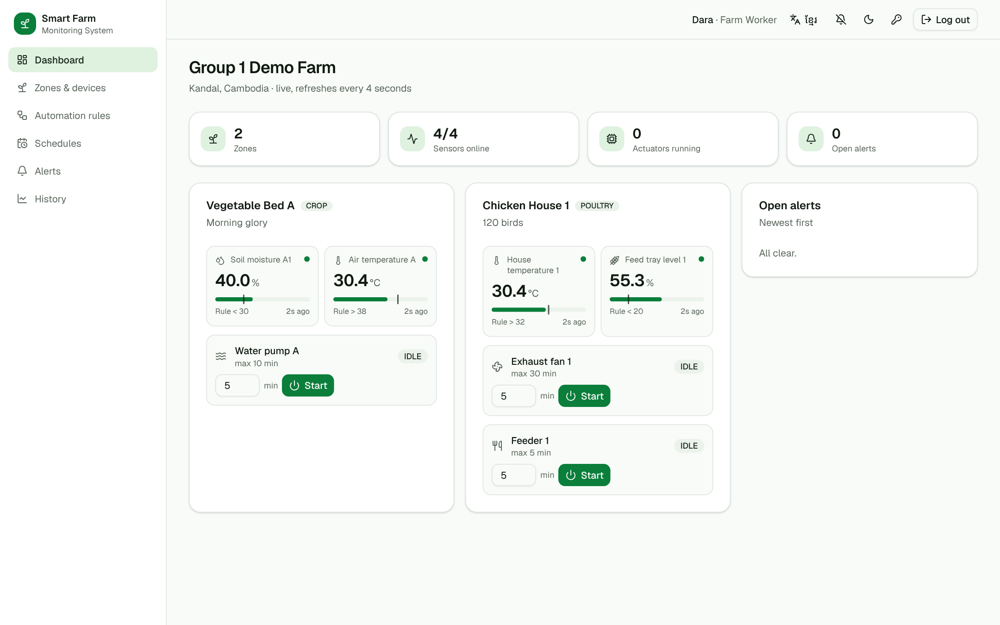
*Figure 9. Dashboard of the Farm Worker*

If the minutes are empty or above the safety limit, a red message appears right under the button and nothing starts.

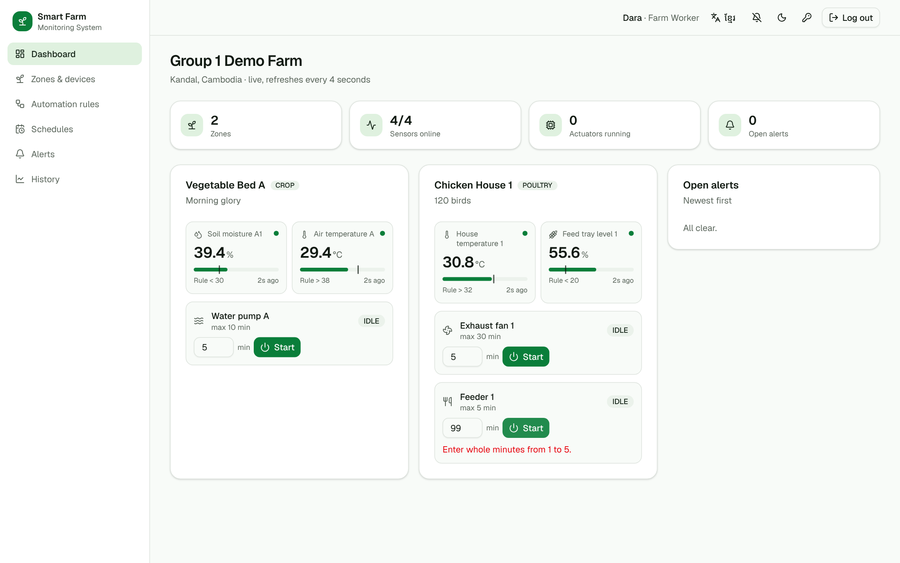
*Figure 10. The minutes must be within the safety limit*

> **Note:** A device in FAULT, OFFLINE or MAINTENANCE cannot be started. Ask the technician.

### 3.3 Critical alerts: banner and sound

When something CRITICAL happens (for example a pump reports a fault, or a rule wanted to start a fan that could not start), a **red banner** appears at the top of every page, also right after you sign in. Click **Alerts** to go to the list, or **×** to hide the banner.

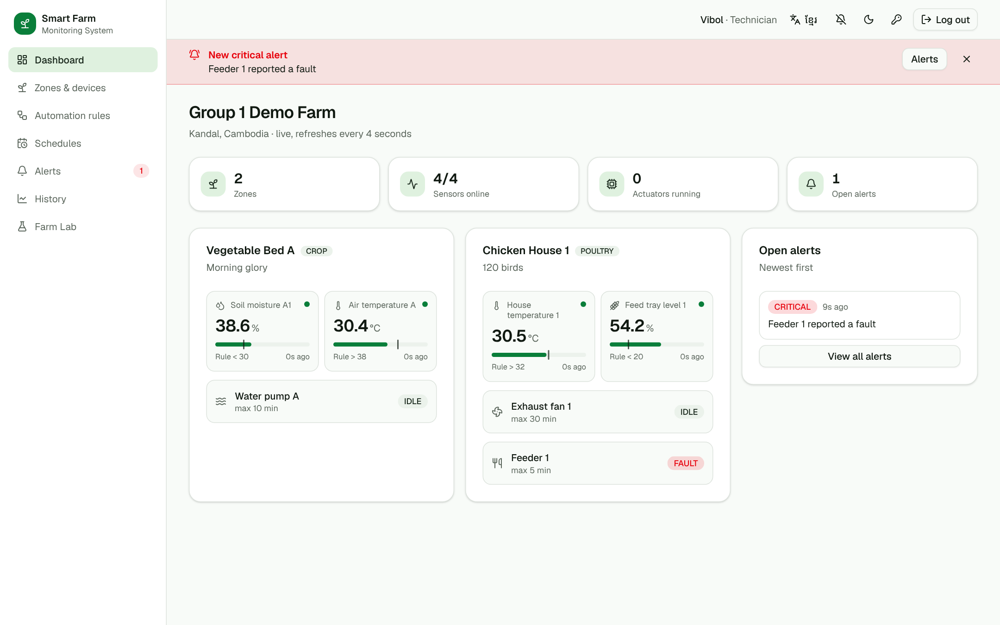
*Figure 11. A critical alert shows on every page*

To also hear a **beep** and get a **pop-up** from the browser, click the **bell icon** at the top (on a phone: More → Alert sound) and allow notifications when the browser asks. Leave the app open in a tab; it checks every 8 seconds.

## 4. Zones and devices

A **zone** is one area of the farm, such as a vegetable bed or a chicken house. Each zone has **sensors** (they measure) and **actuators** (they act).

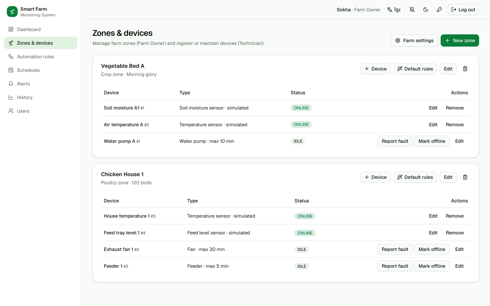
*Figure 12. Zones & devices (Farm Owner)*

### 4.1 Farm name and location (Owner)

Click **Farm settings**, change the name or location, and click **Save**. The dashboard title changes at once.

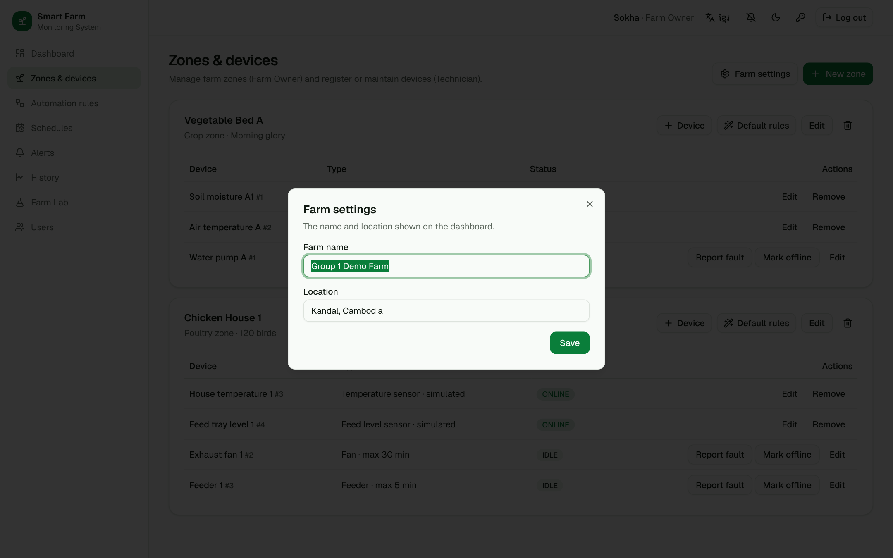
*Figure 13. Farm settings*

The same window has **Allow Smart Farm support to open this farm**. When it is ticked, support staff assigned to your farm can check devices and fix problems from a distance; everything they do appears in the activity log under their name. Untick it and click **Save** to switch their access off at once.

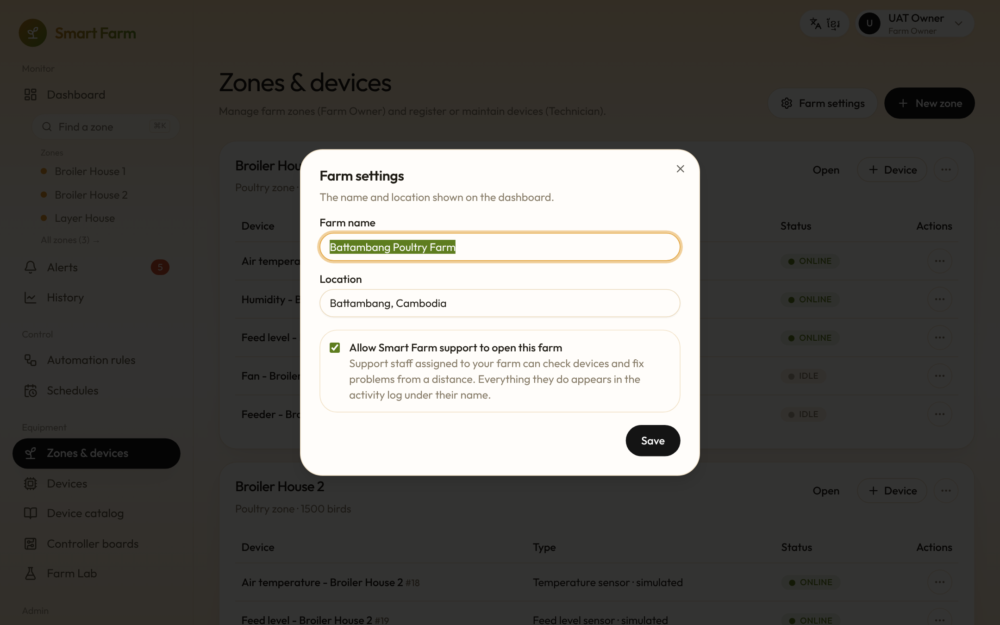
*Figure 14. Farm settings with the support option (Farm Owner)*

### 4.2 Add a zone (Owner)

1. Click **New zone**.
2. Choose the type: **Crop zone** or **Poultry zone**.
3. Type a name (Khmer is fine), and the crop or the number of birds.
4. Click **Save**.

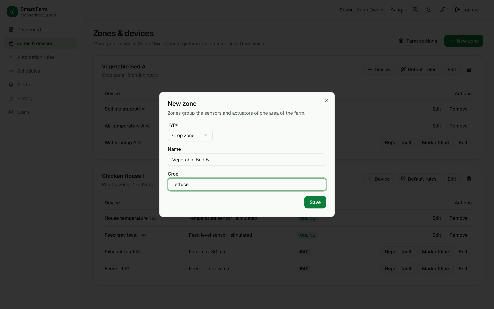
*Figure 15. New zone*

**Default rules** creates the usual rules for the zone type in one click: a crop zone waters dry soil, a poultry zone cools a hot house and refills the feeder. When the zone also has a heater, mister, light or tank valve with its matching sensor, the rules for those are added too (cold house heats, dry air mists, dark switches the light on, low tank opens the valve). **Edit** renames a zone; the **bin icon** deletes it.

> **Note:** Deleting a zone also deletes its devices, readings, rules and schedules. The app asks you to confirm first.

### 4.3 Register a device (Technician)

1. Click **+ Device** on the zone.
2. Choose **Sensor** (soil moisture, temperature, feed level, air humidity, light level, water tank level) or **Actuator** (water pump, fan, feeder, heater, mister, light, tank fill valve) and its type. A line under the type says what it is for. Choosing an actuator fills in a suitable safety limit.
3. Type a name, for example "Soil moisture B1".
4. For a real ESP32 sensor, **untick Simulated**. For an actuator, set the safety limit (the longest it may run).
5. Click **Register**. The device appears in the table with a **#number**. Write it down: the ESP32 needs it.

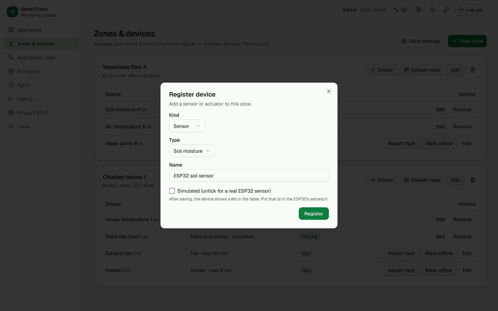
*Figure 16. Register a device*

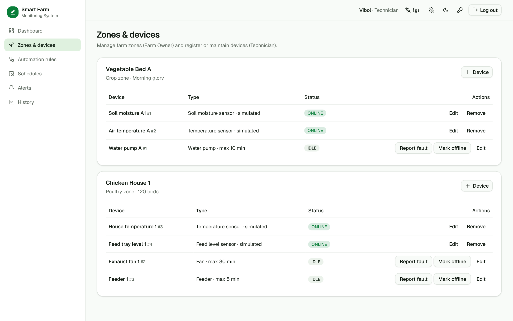
*Figure 17. Zones & devices (Technician)*

### 4.3b The device catalog, Add device and controller boards (Technician, Owner)

- **Device catalog** (menu): every device model the farm can use, with its picture, what it measures or does,
  wiring and price. *Add model* creates your own: name, category, readings (for a sensor) or kind, safety limit
  and effects (for an actuator), a Wokwi drawing or a photo. *Measurement types* adds things to measure
  (for example soil salinity in dS/m). A model in use cannot be deleted: *Retire* it instead.
- **Devices → Add device**: choose the zone, then the model by its picture, then the name, safety limit,
  controller board and notes. A DHT22 gives two readings (temperature and humidity), each with its own #id.
- **Controller boards** (menu): add an ESP32 board to give it its own key. The key and the `secrets.h` lines are
  shown **once**; copy them into the board. *Firmware* shows the settings again (without the key), *New key*
  replaces a lost key. Assign devices to a board when you add them, or from Devices → Edit.

### 4.4 Faults and repairs (Technician)

The buttons next to a device change with its status, so only the actions that make sense are shown. This page refreshes by itself every few seconds.

**Actuators** (pump, fan, feeder, heater, mister, light, tank valve):

| Status | Buttons | What happens |
|---|---|---|
| IDLE or RUNNING | Report fault, Mark offline | The device stops and a CRITICAL or WARNING alert is sent. |
| FAULT | Start repair | The device goes into MAINTENANCE. |
| OFFLINE | Heartbeat restored, Start repair | Back to IDLE, or into MAINTENANCE. |
| MAINTENANCE | Repair done (test passed), Test failed, Decommission | IDLE again; stays in maintenance; or removed from service for good. |

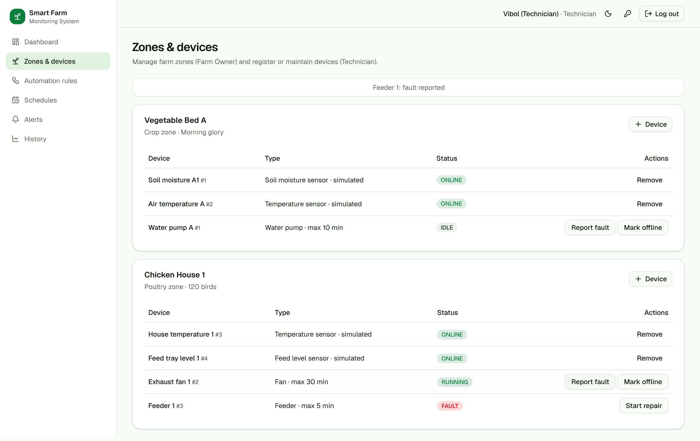
*Figure 18. A feeder in FAULT: only Start repair is offered*

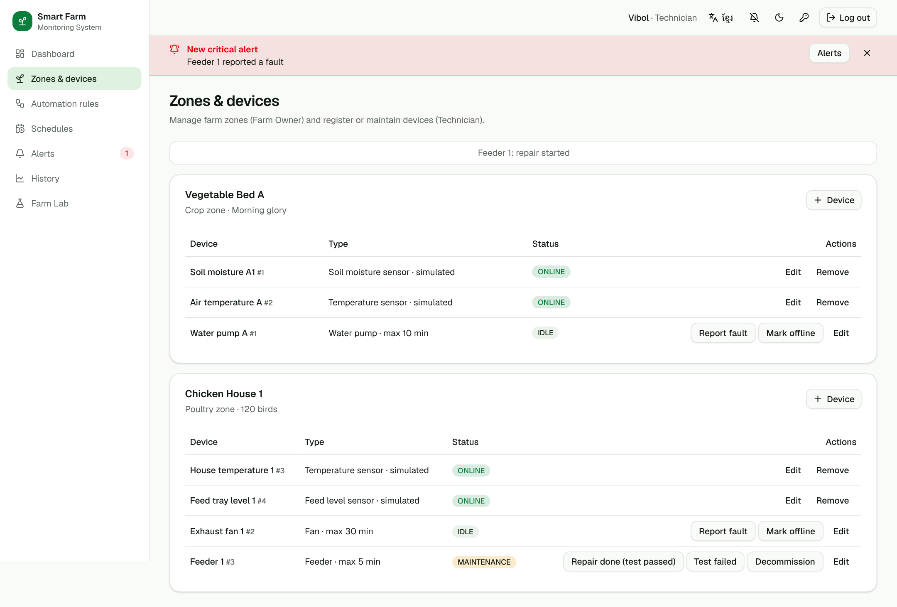
*Figure 19. In MAINTENANCE: finish the repair, record a failed test, or decommission*

**Sensors** have their own repair flow. A sensor that stops sending comes back **by itself** as soon as a valid reading arrives, so a cable you fixed needs no button. Use the buttons when a sensor is broken, stuck or must be tested:

| Status | Buttons | What happens |
|---|---|---|
| ONLINE | Report fault | The sensor is taken out of service: its readings are ignored and its rules are paused, so a stuck sensor cannot run a pump. A WARNING alert tells the farm. |
| OFFLINE | Start repair, Report fault | Into MAINTENANCE, or out of service as faulty. |
| FAULT | Start repair | MAINTENANCE: readings are stored again so you can watch them, but rules stay paused. |
| MAINTENANCE | Complete repair (test) | The test passes only if a valid reading arrived after the repair began. Then the sensor is ONLINE and its rules work again. If not, it stays in MAINTENANCE and the message tells you to check power, cable and Wi-Fi. |

A note under the sensor says what to do next, for example "A valid reading arrived. Complete the repair to put it back in service." Every step is written to the zone's device log (History).

### 4.5 Rename a device or change its safety limit (Technician)

Click **Edit** next to the device. You can rename a sensor, and rename an actuator or change how long it may run in one go (1 to 240 minutes). The **#number** stays the same, so an ESP32 that sends readings for it keeps working.

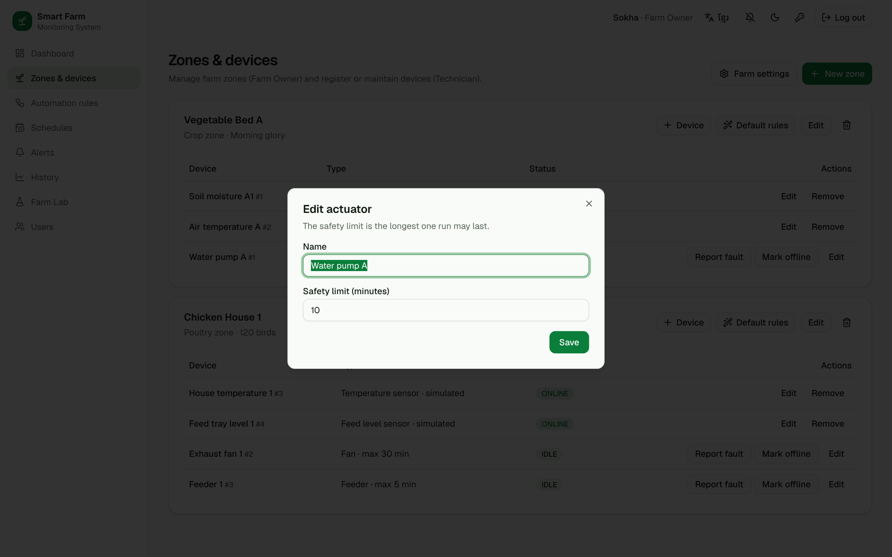
*Figure 20. Edit an actuator*

**Remove** deletes a device after you confirm. A decommissioned actuator can only be removed.

### 4.6 Test without hardware: Farm Lab (Technician, Owner)

No ESP32 yet? **Farm Lab** in the menu creates as many virtual sensors and actuators as you like. They talk to the server exactly like real boards, with the same device key, and behave like a small farm: soil dries and the pump wets it, heat rises and the fan cools it, chickens eat and the feeder refills.

1. Type the **device key** (the server's FARM_DEVICE_KEY; ask the person who installed the server). It is kept only in this browser tab.
2. Owner: click **Create lab farm** for a ready set (a lab vegetable bed and chicken house with a soil, temperature and feed sensor, a pump, a fan, a feeder and rules). Or add devices you registered yourself with **Add**.
3. Click **Power on**. Every 5 seconds each sensor sends its value and each relay asks the server whether to switch on; the coloured lights show the answers.
4. Play with the farm: choose the **weather**, drag a sensor's slider, **Unplug** a sensor, **Send impossible value**, or tick “Runs but does nothing” on a pump.
5. Or click **Run** next to a scenario, or **Run all scenarios** (about 20 minutes). Each one reports **PASS**, **FAIL** or **KNOWN GAP**.

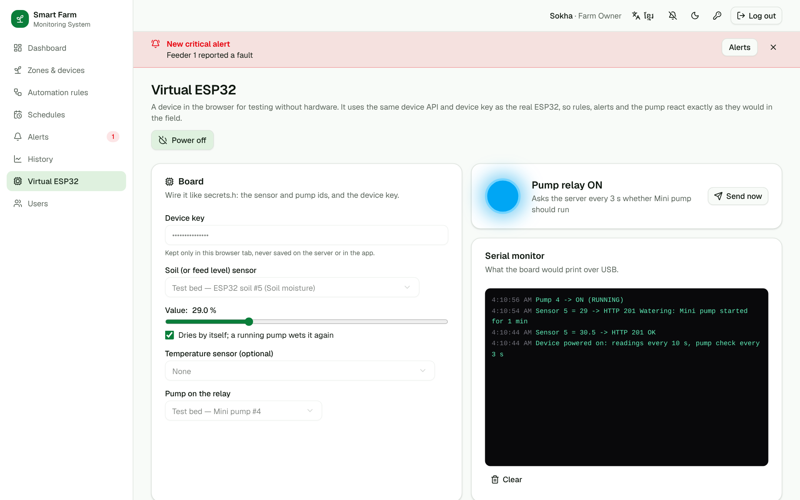
*Figure 21. Farm Lab during the Dry spell scenario: the server has started the pump*

| Scenario | What happens | Expected |
|---|---|---|
| Normal day | Mild weather | Nothing starts, no alert |
| Dry spell | Soil dries quickly | Pump starts below 30 % |
| Heavy rain | Soil gets wet | Pump stays off |
| Heat wave | House heats towards 39 °C | Fan starts above 32 °C |
| Cool night | 21 °C | Fan stays off |
| Cold snap | House drops towards 10 °C | Heater starts below 18 °C |
| Dry air | Humidity falls to 20 % | Mister starts below 40 % |
| Dark day | Storm clouds | Light switches on below 5000 lux |
| Tank running low | A leak drains the tank | Tank valve opens below 20 % |
| Feed running out | Chickens eat fast | Feeder refills below 20 % |
| Broken pump | Pump reported faulty, soil dries | CRITICAL alert: pump could NOT start |
| Clogged pipe | Pump runs, no water | Known gap: nothing says so yet (needs a flow sensor) |
| Sensor cable cut | Soil sensor silent | “is offline” alert after about 2 min |
| Faulty sensor reading | Sensor reports 150 % | Rejected (HTTP 422) |
| Sensor repaired | Soil sensor faulty while the bed dries, then repaired | Pump stays off during the fault and repair, starts after the repair |
| Power cut | Every device silent | “is offline” for every sensor; relays off |

> **Note:** To run our real ESP32 program on a simulated board, see firmware/esp32-node/WOKWI.md in the project.

## 5. Automation rules (Owner)

A rule says: **IF** a sensor reading goes above or below a value **THEN** start an actuator for some minutes and send an alert. Rules work day and night, also when nobody is looking.

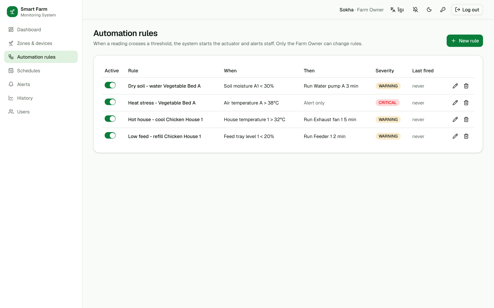
*Figure 22. Automation rules*

### 5.1 Create a rule

1. Click **New rule** and give it a clear name, for example "Dry soil - water bed A".
2. Choose the **sensor**, the **condition** (Below or Above) and the **threshold**. The range the sensor can measure is shown under the box.
3. Choose the **actuator** in the same zone and how many minutes it should run, or choose **None (alert only)** to only be warned.
4. Choose the **severity**: Info, Warning or Critical.
5. Set the **cooldown**: the rule fires at most once in this many minutes, so you are not flooded with alerts.
6. Click **Save rule**.

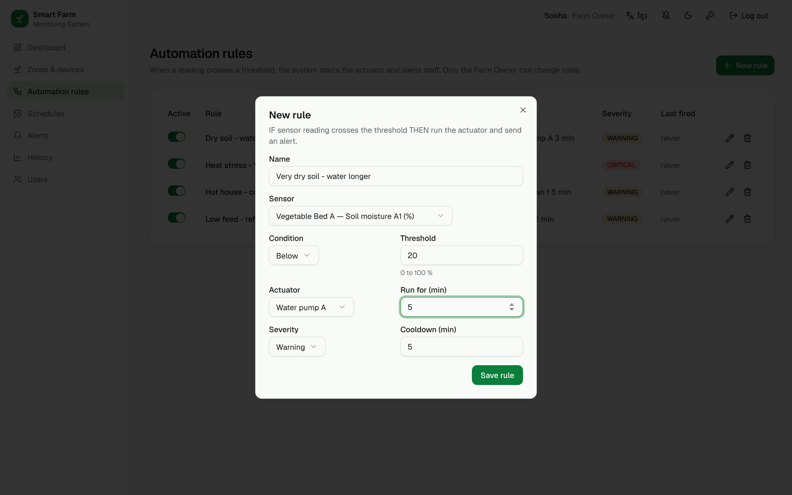
*Figure 23. New rule*

Use the switch in the **Active** column to pause a rule without deleting it. The pencil edits a rule; the bin deletes it. Workers and technicians see the rules but cannot change them.

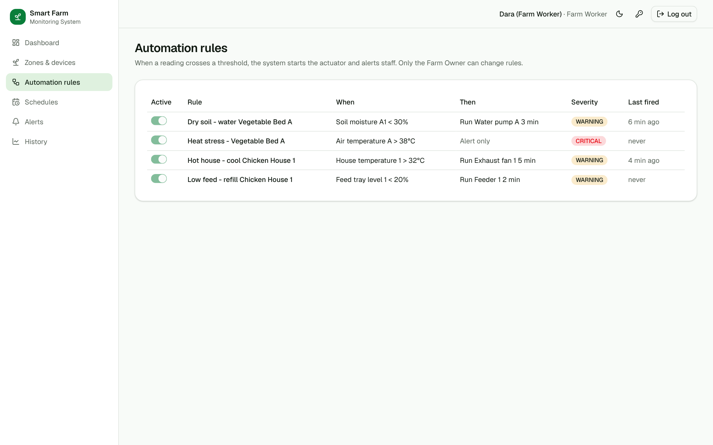
*Figure 24. Rules as seen by a Farm Worker (read only)*

## 6. Schedules (Owner)

A schedule starts an actuator at a fixed time on chosen days, for example feeding at 07:00 every day. Times are **farm time** (the time zone is shown at the top of the page).

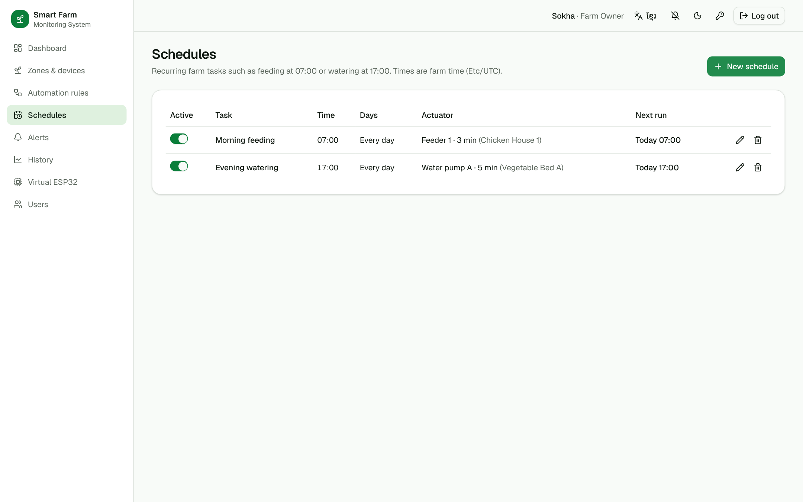
*Figure 25. Schedules with their next run*

1. Click **New schedule** and type a name.
2. Choose the actuator, the time and how many minutes it runs.
3. Click the days to switch them on or off (green = on).
4. Click **Save schedule**. The **Next run** column tells you when it will start.

*Figure 26. New schedule*

To change a schedule, click the **pencil** in its row, change the time, days, actuator or minutes, and click **Save schedule**. A task that already ran today does not run twice if you move it later. The **bin** deletes a schedule after you confirm.

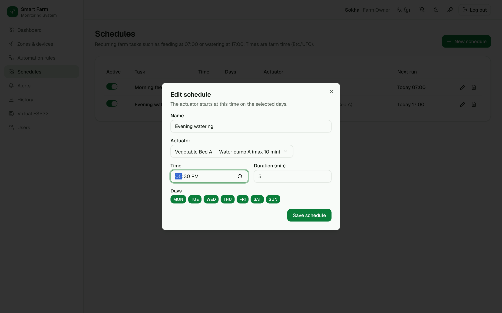
*Figure 27. Edit a schedule*

> **Note:** If the server was off at the scheduled time, the task still runs if the server is back within 15 minutes. Otherwise it waits for the next selected day.

## 7. Alerts

An alert is created when a rule fires, when a device reports a fault or goes offline, or when a sensor stops sending readings for 2 minutes.

| Severity | Meaning |
|---|---|
| INFO | For your information; no action needed. |
| WARNING | Something needs attention soon, for example dry soil (the pump has usually been started already). |
| CRITICAL | Act now: a device is broken, or a rule wanted to start a device that could not start. |

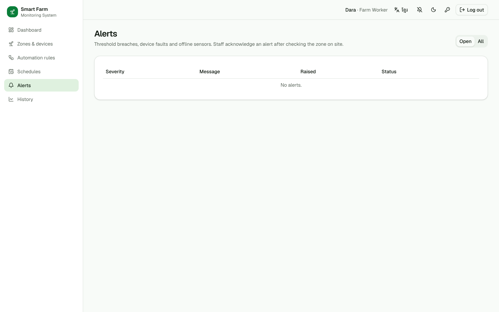
*Figure 28. Alerts as seen by a Farm Worker*

1. Read the alert and **go and check the zone**.
2. Click **Acknowledge**. Your name is saved with the alert.
3. After checking the whole farm you can click **Acknowledge all**.

The **Open** tab shows alerts still waiting; **All** also shows acknowledged ones and who acknowledged them. If the same problem happens again before anyone acknowledges it, it is counted on the same alert ("happened 2 times") instead of filling the list with copies.

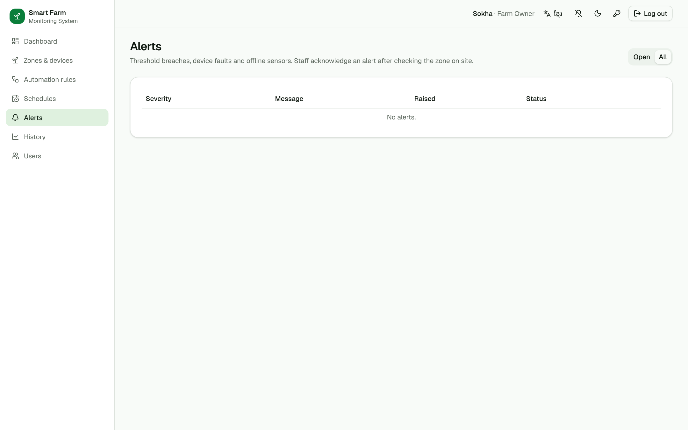
*Figure 29. All alerts, including acknowledged ones*

## 8. History and reports

The quickest way in: click a sensor tile on the dashboard. History opens with that sensor already chosen.

1. Choose a **zone** and a **sensor**.
2. Click a quick range (**Last hour**, **24 hours**, **7 days**, **30 days**), or set **From** and **To** and click **Show**.
3. Read the chart. The red dashed line is the rule's threshold. Move the mouse over the line to see exact values. Long ranges are shown with at most 500 points so the chart stays fast.
4. The **Device activity** list shows every start and stop, who or what did it (rule, schedule, safety, a person) and why.
5. Click **Download CSV** to save every reading in the range as a file that opens in Excel or Google Sheets, for reports or a teacher.

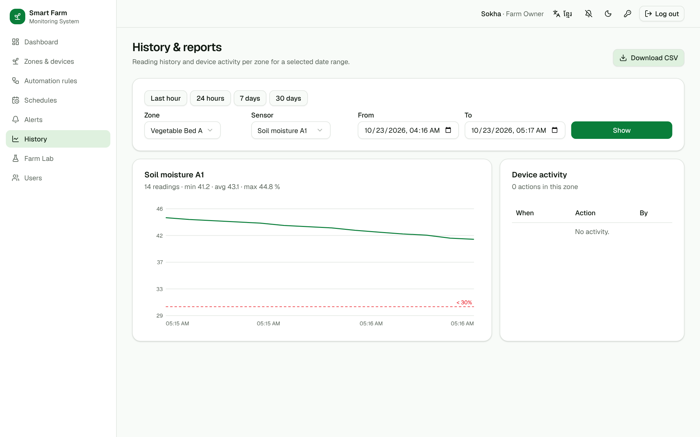
*Figure 30. History & reports*

> **Note:** Readings are kept for 90 days, then deleted to keep the server fast. Download a CSV if you need them longer. Alerts and device activity are kept.

## 9. Using a phone

The app works in the phone's browser. The menu sits at the **bottom of the screen**, within reach of your thumb: **Home**, **Alerts** (with the number still open), **History**, **Zones** and **More**. Lists turn into cards so that messages and statuses stay readable.

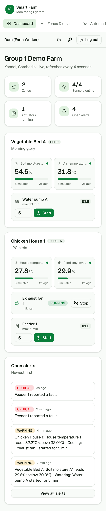
*Figure 31. Dashboard on a phone*

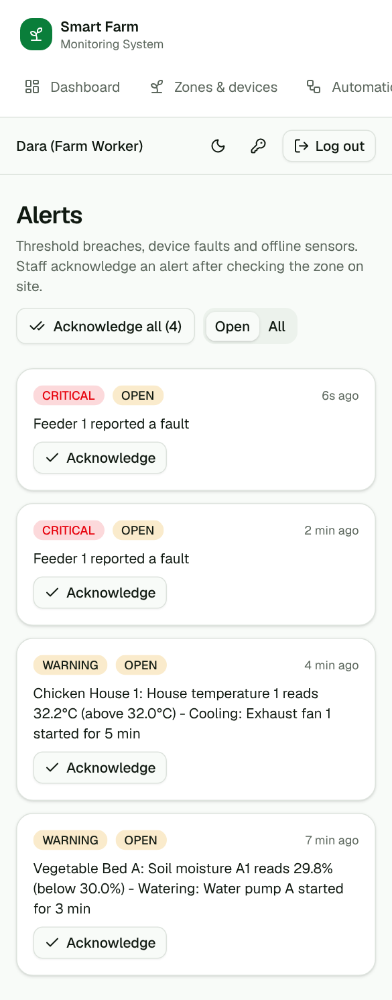
*Figure 32. Alerts on a phone*

**More** opens the other pages (Automation rules, Schedules, and Users for the owner) and the settings: language, alert sound, dark mode, change password and log out.

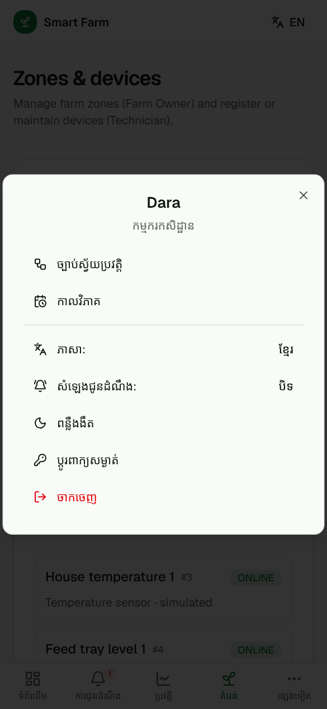
*Figure 33. The More menu on a phone, in Khmer*

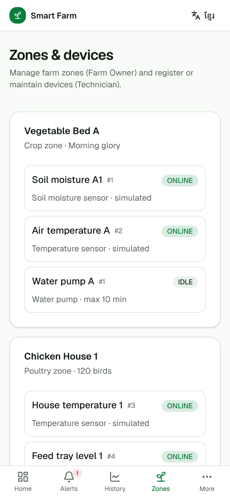
*Figure 34. Zones & devices on a phone*

## 10. Staff accounts (Owner)

Open **Users** in the menu. Every person should have their own account, so the history shows who did what.

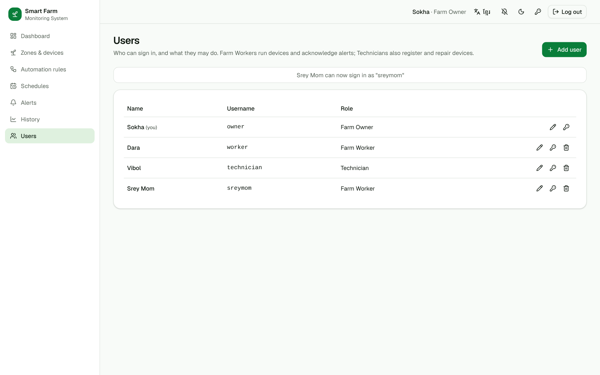
*Figure 35. Staff accounts*

### 10.1 Add a person

1. Click **Add user**.
2. Type their full name and a **username** (3-30 letters, numbers, dots or dashes, no spaces).
3. Choose the **role**: Farm Worker, Technician, or Farm Owner (full access).
4. Type a first password of at least 8 characters and click **Save**.
5. Tell the person their username and password in person. They should change the password with the key icon.

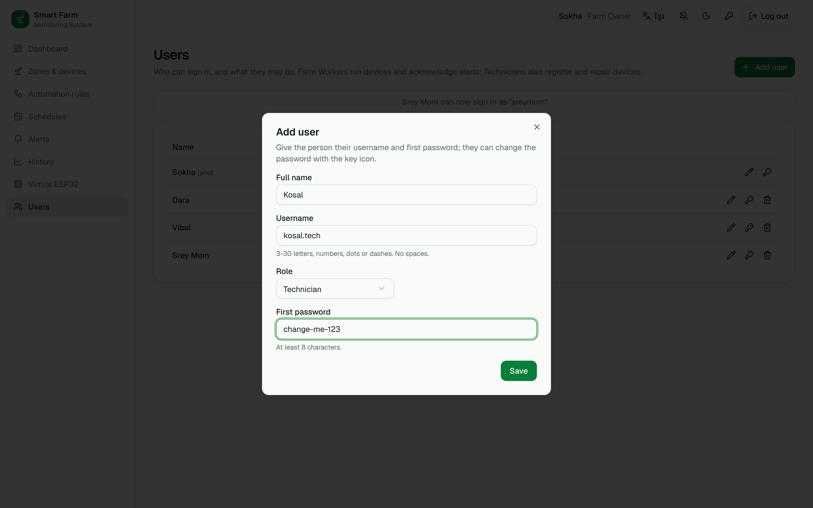
*Figure 36. Add a user*

### 10.2 Change a role, reset a password, remove a person

- The **pencil** changes the name or role. The farm always keeps at least one Farm Owner.
- The **key** sets a new password for someone who forgot theirs or was locked out. They are signed out on all their devices.
- The **bin** removes a person who left the farm. Their name stays in old alerts and device activity. You cannot remove yourself.

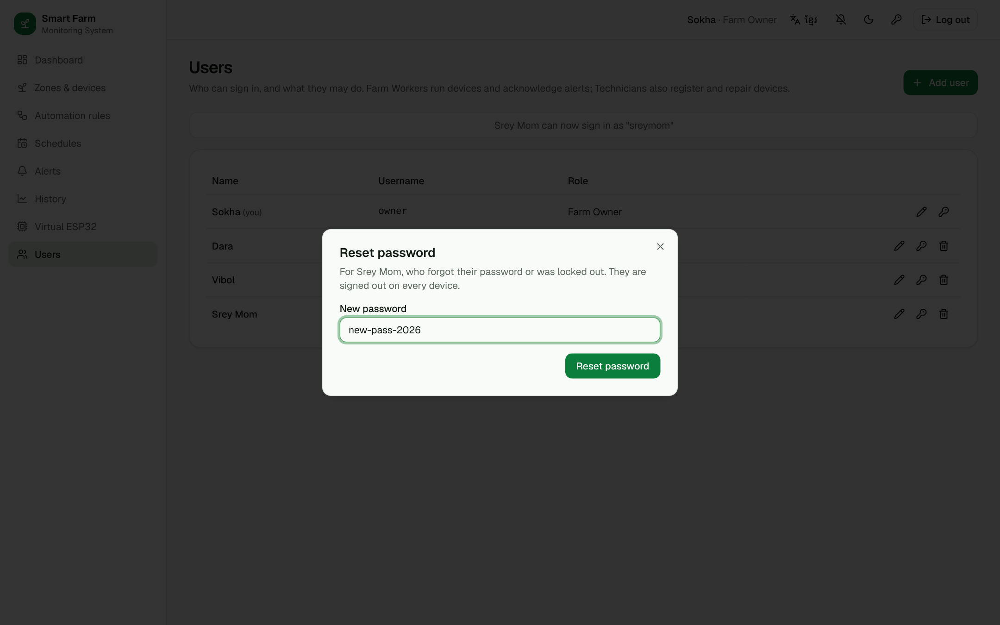
*Figure 37. Reset a password*

## 11. Smart Farm company: customer farms and staff

Smart Farm is run by a company that sets farms up for its customers. One server holds every customer's farm, and **each farm sees only its own data**: zones, devices, readings, rules, schedules, alerts and people. If someone asks for an item of another farm, the app simply answers "not found".

| Account | Belongs to | Works as |
|---|---|---|
| Company Admin | The company | Creates farms, invites owners and staff, assigns support, suspends farms. Opens any farm as its **owner**. |
| Company Support | The company | Opens only the farms assigned to them, as a **technician**, and only while the farm's owner allows support. |
| Farm Owner, Technician, Worker | One farm | As in the chapters above, on their own farm only. |

Company people sign in like everyone else, and see the **Smart Farm company** menu: **Customer farms** and **Company staff**.

### 11.1 See all customer farms (Admin, Support)

Open **Customer farms**. The top cards show how many farms there are, how many need attention (offline sensors, no data, or open alerts), sensors online and open alerts. Farms that need attention come first, 20 at a time; use the search box (farm, place or owner) or the **All / Need attention / Suspended** buttons. A support person sees only the farms assigned to them.

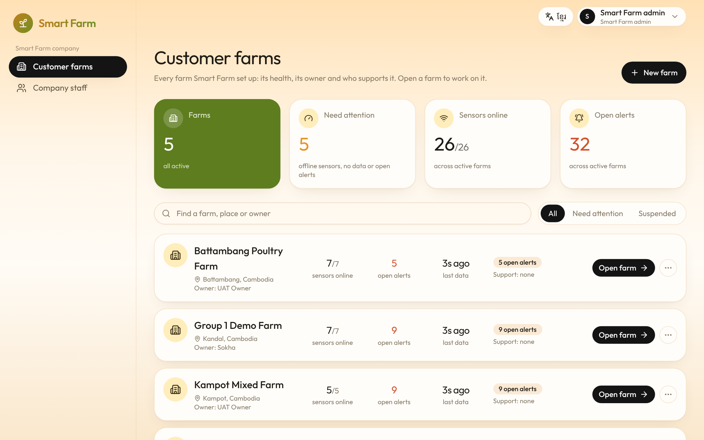
*Figure 38. Customer farms (Company Admin)*

### 11.2 Create a farm for a new customer (Admin)

1. Click **New farm**.
2. Type the **farm name** and **location**, then the owner's **name**, **username** (3-30 small letters, numbers, dots or dashes) and phone or Telegram.
3. Click **Create farm and invite link**. The farm starts empty.
4. Click **Copy link** and send it to the owner. **The link is shown only once.** If it is lost, open the farm's **...** menu and choose **New owner invite link**.
5. The owner opens the link and sets their own password (section 2.1b). Then they or you add zones and devices.

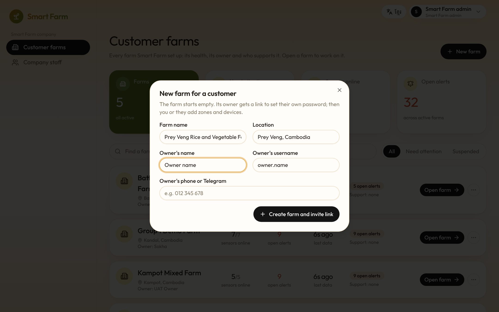
*Figure 39. New farm for a customer*

The **...** menu of a farm (Admin) also has **Edit details**, **Assign support staff**, and **Suspend farm** or **Reactivate farm**. A suspended farm keeps its data and keeps running its automation rules, but its people cannot use the app until it is reactivated.

### 11.3 Work on a farm (Admin, Support)

Click **Open farm**. A bar at the top says **Working on** and the farm's name, with your role there ("as its owner" for an admin, as a technician for support). Everything you see and change is on that farm only. Click **Back to customer farms** to leave it.

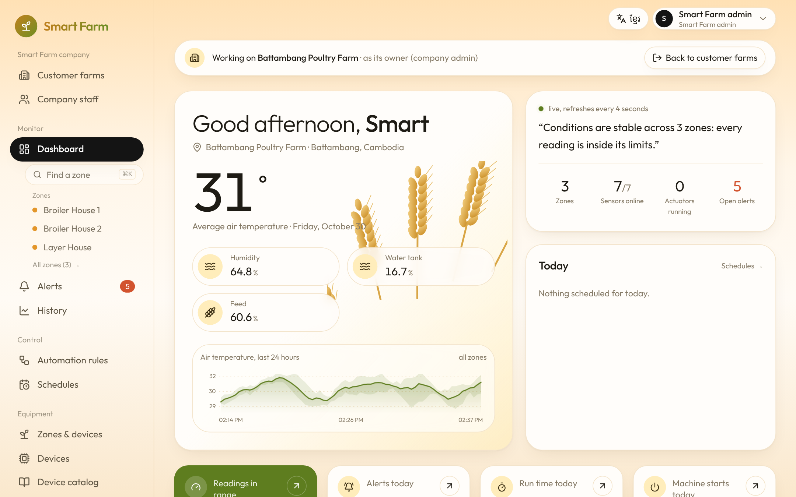
*Figure 40. Working on a customer farm*

Support can open a farm only if **both** are true: an admin assigned them to it, and the owner has not switched support off (section 4.1). Otherwise the app says so (see the Troubleshooting table).

### 11.4 Company staff (Admin)

Open **Company staff** and click **Add staff**. Type a name and username and choose **Admin** (makes farms, invites owners, manages staff, opens any farm as its owner) or **Support** (opens assigned farms as a technician). You get an invite link to send, exactly like for an owner.

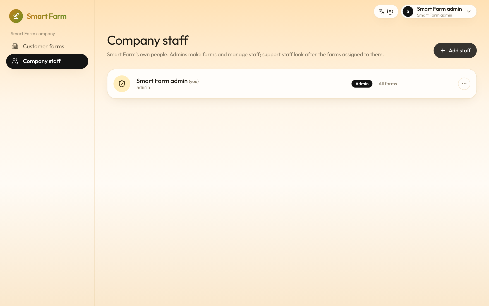
*Figure 41. Company staff*

### 11.5 The device catalog

Company staff keep the shared **Device catalog** (sensor and actuator models used by every farm). A farm's owner or technician can add models only that farm sees (section 4.3b).

## 12. Troubleshooting

| What you see | What to do |
|---|---|
| "Wrong username or password" | Check the username and password. Ask the owner if you forgot the password. |
| "Too many wrong passwords. Wait N min" | Wait, or ask the Farm Owner to reset your password (Users → key icon), which unlocks it at once. |
| "A Farm Worker account cannot do this" | The page or action is for another role. Ask the Farm Owner. |
| "Cannot reach the server... Retrying" | The backend computer is off or the network is down. The page reconnects by itself when it is back. |
| "This link no longer works" | The invite link was already used or is older than 7 days. Ask Smart Farm for a new one. |
| "This farm is suspended. Please contact Smart Farm." | The company paused this farm. Its data is kept and its automation still runs; contact Smart Farm to reactivate it. |
| "You are not assigned to <farm>. Ask a company admin." (Support) | A company admin must assign the farm to you (farm menu, **Assign support staff**). |
| "The owner of <farm> has turned off support access." (Support) | Ask the farm's owner to tick **Allow Smart Farm support to open this farm** in Farm settings. |
| "Your session ended" | Sign in again. This happens after 12 hours, or when your password was reset. |
| A sensor dot is red / "is offline" alert | The sensor sent nothing for 2 minutes. Check its power, cable and Wi-Fi (Technician). It comes back by itself with the next valid reading; to test it, use Start repair then Complete repair (section 4.4). |
| A sensor is greyed out and says FAULT or MAINTENANCE | A technician took it out of service. Its readings are ignored or its rules are paused until the repair is completed (section 4.4). |
| "Complete repair" says the test failed | No valid reading has arrived since the repair began. Check power, cable and Wi-Fi, wait for a reading, and try again. |
| A value says "suspect" | The sensor sent an impossible value (for example 150 %). Check or recalibrate it. |
| "Enter whole minutes from 1 to N" | Type a whole number of minutes within the device's safety limit. |
| "Cannot start ...: it is FAULT" | The device is broken or in repair. The technician must finish the repair first. |
| "Threshold must be between ..." | Choose a threshold the sensor can actually measure. |
| A schedule did not run | Check that it is Active, the day is selected, and the Next run time. The server must be on at that time. |

## 13. Glossary

| Word | Meaning |
|---|---|
| Zone | One area of the farm: a crop bed or a chicken house. |
| Sensor | A device that measures: soil moisture (%), temperature (°C) or feed level (%). |
| Actuator | A device that acts: water pump, fan or feeder. |
| Simulated | A sensor whose values come from the built-in simulator, for demos and training. |
| Rule | IF a reading crosses a threshold THEN start an actuator and/or send an alert. |
| Threshold | The value a reading is compared with, for example 30 % soil moisture. |
| Cooldown | Minutes a rule waits before it may fire again. |
| Safety limit | The longest an actuator may run in one go. It always switches off by itself. |
| Schedule | An actuator start at a fixed time on chosen days. |
| Acknowledge | Confirm you have seen an alert and checked the zone. |
| CSV | A simple table file that Excel and Google Sheets open. |
| Customer farm | One farm that Smart Farm set up for a customer. Each customer farm sees only its own data. |
| Invite link | A one-time link, valid for 7 days, with which a new owner or staff member sets their own password. |
| Company Admin / Support | Smart Farm's own people: admins make farms and manage staff; support looks after assigned farms. |
| Support access | The owner's permission for assigned support staff to open the farm as a technician. |
| Suspended | A farm paused by the company: data kept, automation running, people locked out. |
